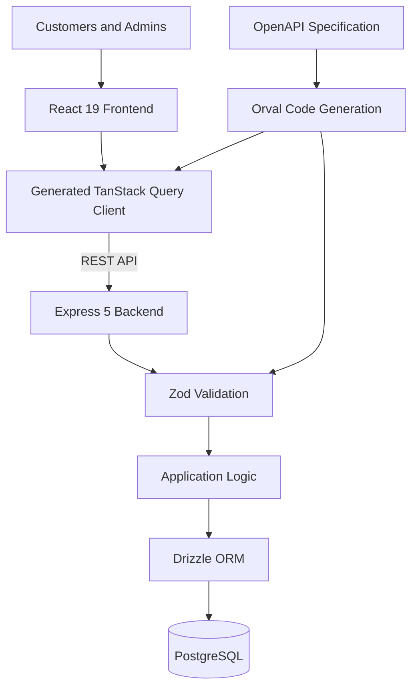
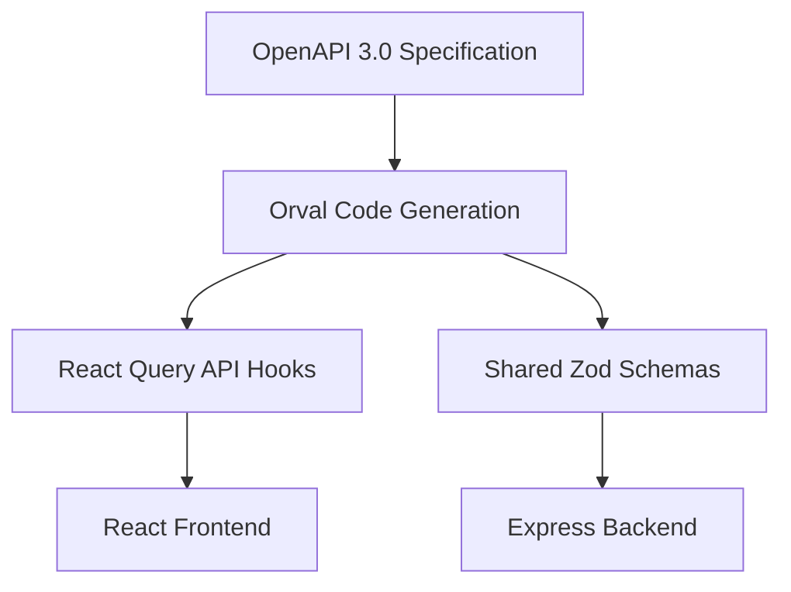
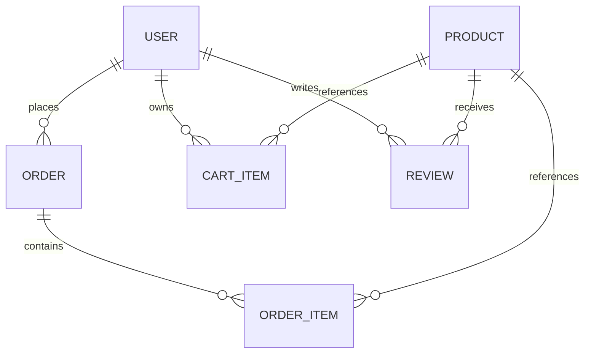

<div align="center">


# 🌿 Desiri Naturals

### Full-Stack Farm-to-Table E-Commerce Platform

**From farm to your doorstep.**

[](https://github.com/9harshithp/Desiri-Naturals/actions/workflows/ci.yml)
[](https://desiri-naturals-km63.vercel.app/)
[](#technology-stack)
[](#technology-stack)
[](#technology-stack)
[](#api-architecture)

</div>

---

## 🖥️ Application Showcase

<div align="center">

[](https://desiri-naturals-km63.vercel.app/)

*Premium natural products and farm-fresh produce shopping experience.*

[](https://desiri-naturals-km63.vercel.app/)

</div>

---

## 📌 Project Overview

Desiri Naturals is a full-stack e-commerce platform designed to connect customers with traditionally produced natural products and farm-fresh produce.

The platform features a modern shopping experience, product catalog management, delivery availability validation, shopping carts, customer reviews, order management and invoice generation.

Its engineering architecture combines a TypeScript monorepo, contract-driven API development, shared validation schemas and generated frontend API clients.

**Live Website:** https://desiri-naturals-km63.vercel.app/

---

## 🌟 Product Categories

| Category | Description |
|---|---|
| 🌻 Bull-driven oils | Traditionally extracted cooking oils |
| 🐄 A2 Desi ghee | Traditional cow ghee products |
| 🌾 Organic staples | Everyday grains and pantry products |
| 🥬 Fresh produce | Farm-fresh fruits and vegetables |

---

## 🚀 Platform Features

### 🛒 Customer Experience

- Product discovery and category filtering.
- Product search.
- Shopping cart management.
- Customer authentication.
- Guest shopping cart sessions.
- Pincode-based delivery availability.
- Delivery estimation.
- Order management.
- PDF invoice generation.
- Customer reviews and freshness scores.
- WhatsApp ordering and customer support.

### ⚙️ Administration

- Role-based administrator access.
- Product catalog management.
- Customer and order management.
- Catalog synchronization.
- Product and category database seeding.

---

## 💻 Technology Stack

<div align="center">

### Frontend


### Backend & Database


### Development & Deployment


</div>

| Layer | Technology |
|---|---|
| Frontend | React 19, Vite |
| Language | TypeScript |
| Styling | Tailwind CSS v4, shadcn/ui |
| Routing | Wouter |
| Server State | TanStack Query |
| Backend | Node.js, Express 5 |
| Database | PostgreSQL |
| ORM | Drizzle ORM |
| Runtime Validation | Zod |
| API Contract | OpenAPI 3.0 |
| Code Generation | Orval |
| Package Management | pnpm Workspaces |
| Backend Bundling | esbuild |
| Frontend Deployment | Vercel |

---

## 🏗️ System Architecture



### Architecture Highlights

- Modular TypeScript monorepo.
- Shared libraries between applications.
- Contract-driven API development.
- Generated, typed frontend API clients.
- Centralized runtime validation.
- Database schema management using Drizzle ORM.
- Separation of frontend and backend responsibilities.

---

## 🔌 API Architecture

Desiri Naturals uses OpenAPI as a shared contract for API communication.



### API Modules

| Module | Purpose |
|---|---|
| Authentication | Customer and administrator authentication |
| Products | Product catalog and discovery |
| Orders | Customer order management |
| Cart | Guest and authenticated cart operations |
| Pincode | Delivery availability validation |
| Reviews | Customer reviews |
| Invoices | PDF invoice generation |

**API specification:** [openapi.yaml](lib/api-spec/openapi.yaml)

---

## 🗄️ Conceptual Database Design



The diagram illustrates conceptual e-commerce relationships.

For the actual PostgreSQL schema, table definitions and relationships, refer to:

[lib/db/src/schema.ts](lib/db/src/schema.ts)

---

## ⚡ Engineering Highlights

| Engineering Area | Implementation |
|---|---|
| Monorepo Architecture | pnpm Workspaces |
| Type Safety | End-to-end TypeScript |
| API Contracts | OpenAPI 3.0 |
| API Client Generation | Orval-generated React Query hooks |
| Request Validation | Shared Zod schemas |
| Database Management | Drizzle ORM and PostgreSQL |
| Session Management | Cookie-based sessions |
| Authorization | Customer and administrator roles |
| Inventory | Structured catalog data |
| User Experience | Responsive e-commerce interface |

---

## 📁 Repository Structure

```text
Desiri-Naturals/
├── apps/
│   ├── frontend/
│   └── backend/
├── lib/
│   ├── api-client-react/
│   ├── api-spec/
│   ├── api-zod/
│   └── db/
├── scripts/
├── docs/
│   └── screenshots/
│       └── desiri-homepage.png
├── package.json
├── pnpm-workspace.yaml
├── tsconfig.json
└── README.md
```

---

## 🚀 Quick Start

### Prerequisites

- Node.js v20+ (v24 recommended)
- pnpm v9+
- PostgreSQL v15+
- Git

### 1. Clone the Repository

```bash
git clone https://github.com/9harshithp/Desiri-Naturals.git
cd Desiri-Naturals
```

### 2. Configure Environment Variables

Create a `.env` file in the project root.

```env
DATABASE_URL=postgres://<user>:<password>@localhost:5432/desiri
PORT=5000
VITE_PORT=3000
```

### 3. Install Dependencies

```bash
pnpm install
```

### 4. Initialize the Development Database

```bash
pnpm run db:push
pnpm run db:seed
```

Use a development database when running schema and seed commands.

### 5. Start the Frontend

```bash
pnpm run dev:frontend
```

Frontend:

```text
http://localhost:3000
```

### 6. Start the Backend

In a separate terminal:

```bash
pnpm run dev:backend
```

Backend:

```text
http://localhost:5000
```

---

## 🛠️ Available Scripts

| Command | Description |
|---|---|
| `pnpm run dev` | Starts the frontend development server |
| `pnpm run dev:frontend` | Starts the React frontend |
| `pnpm run dev:backend` | Builds and starts the Express API |
| `pnpm run build` | Typechecks and builds workspace applications |
| `pnpm run typecheck` | Runs TypeScript validation |
| `pnpm run db:push` | Updates the development database schema |
| `pnpm run db:seed` | Seeds the product catalog |
| `pnpm --filter @workspace/api-spec run codegen` | Regenerates API clients and validation schemas |

---

## 🧪 Quality Assurance

### Type Checking

```bash
pnpm run typecheck
```

### Application Build Validation

```bash
pnpm run build
```

### API Client Generation

```bash
pnpm --filter @workspace/api-spec run codegen
```

Additional automated unit, integration and end-to-end tests are future quality-improvement opportunities.

---

## 🔐 Security Architecture

- Cookie-based session management.
- Separate guest and authenticated sessions.
- Role-based access control.
- Shared request-validation schemas.
- Environment-based database configuration.
- Separation of customer and administrator workflows.

Configure dedicated demonstration accounts for local testing. Never reuse development credentials in production or expose database passwords in source control.

---

## ☁️ Deployment

| Component | Platform |
|---|---|
| Frontend | Vercel |
| Backend | Express REST API |
| Database | PostgreSQL |
| Source Control | GitHub |

**Live application:** https://desiri-naturals-km63.vercel.app/

---

## 🛣️ Development Roadmap

- [x] Product catalog
- [x] Responsive storefront
- [x] Shopping cart
- [x] Customer authentication
- [x] Administrator roles
- [x] Pincode delivery validation
- [x] Invoice generation
- [x] Contract-driven APIs
- [x] Vercel frontend deployment
- [ ] Expanded automated testing
- [ ] CI/CD quality pipeline
- [ ] Production monitoring
- [ ] Additional performance optimization

---

## 🤝 Contributing

Suggestions and improvements are welcome through GitHub issues and pull requests.

---

<div align="center">

## 👨‍💻 Developer

### Harshith P

Backend Engineer | Full Stack Developer

[](https://github.com/9harshithp)
[](https://www.linkedin.com/in/harshithp914)
[](mailto:harshithp914@gmail.com)

⭐ If you find Desiri Naturals interesting, consider starring the repository.


</div>
